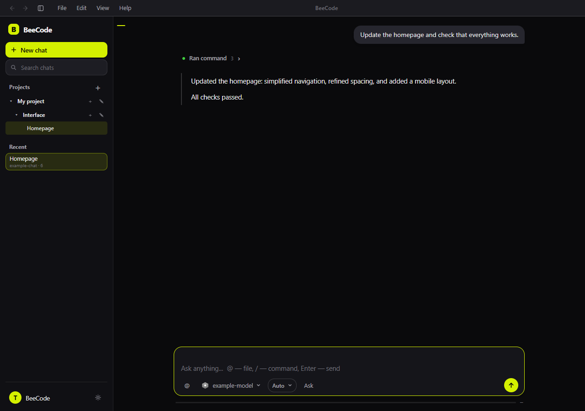
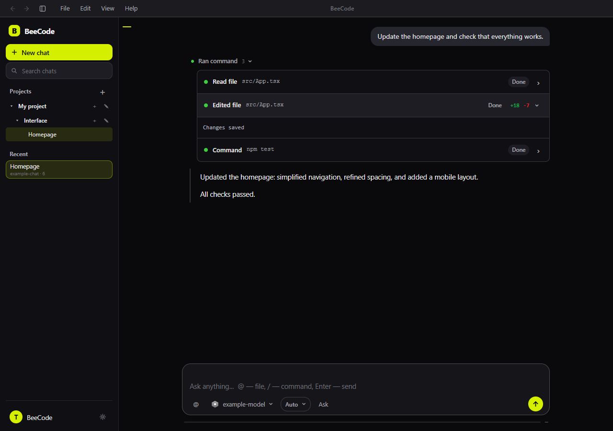

# BeeCode

BeeCode is an AI coding agent for the terminal and Windows desktop. It can work with files and commands, use MCP servers and skills, and delegate research to subagents. Tool permissions are configurable.



*Illustrative session with demonstration data and translated interface labels.*

## Windows desktop

Download **BeeCode.Rust.Setup.5.0.2.exe** from [Releases](https://github.com/egorVasile/beecode/releases) and run the installer. The desktop uses a Rust shell and WebView2; it requires Python 3.10 or newer. On first launch it creates a Python environment and may download dependencies.

The desktop source, bundled agent, build scripts and installer configuration are in [`desktop/`](desktop/). Desktop and CLI versions are numbered separately.


*Expand tool activity to inspect each action and its result.*

## Terminal

Requires Python 3.10 or newer. Install from the repository:

```bash
pip install git+https://github.com/egorVasile/beecode.git
cd path/to/your/project
beecode
```

You can configure a provider and model in BeeCode. Availability, costs and reasoning options depend on the provider and model.

## Local data

BeeCode stores configuration, provider keys and conversation history locally. Keep `beeagent.json` and `.beeagent/` out of project commits; they can contain credentials and chat content.

## License

[GPL-3.0-or-later](LICENSE).
